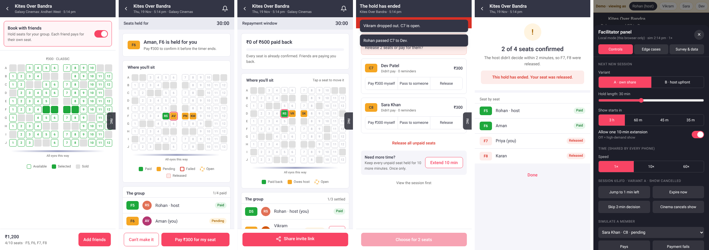

# BMS-group: group booking session prototype

A clickable, mobile-first prototype of a **group booking session** for movie tickets, built from the PRD (19 Nov 2026). Two payment variants run on the same screens:

- **Variant A: everyone pays their own share.** The host pays for their own seat; other seats are held on a shared timer.
- **Variant B: host pays upfront.** Every seat is confirmed at once; friends pay the host back within the window.



Payments, OTPs, seat locks and notifications are all simulated. No real card or UPI details are collected.

## Run it

```bash
npm install
npm run dev          # http://localhost:5173
```

Without Supabase keys the app runs in **local mode**: state lives in the browser and syncs across tabs in that browser. This is good for solo walkthroughs.

| URL | What it does |
| --- | --- |
| `/?facilitator=1` | Shows the facilitator tab on the right edge (or long-press the dark header on any screen) |
| `/?variant=A` / `?variant=B` | Sets the variant for the next new session |
| `/?demo=1` | Single-device demo: a bar at the top switches between host and members |
| `/s/<id>?as=<memberId>` | Makes this tab act as a given member (the facilitator's "Open their view" uses this) |

## Multi-phone testing (the main build)

1. Create a free Supabase project, open the SQL editor and run `supabase/setup.sql`.
2. Copy `.env.example` to `.env.local` and fill in the project URL and **anon** key (Settings → API).
3. Deploy:
   - **Vercel:** import the repo, framework "Vite", add the same two env vars. `vercel.json` handles `/s/<id>` links.
   - **Netlify:** build `npm run build`, publish `dist`, add the env vars. `public/_redirects` handles links.
4. Open the deployed URL on the host's phone, create a session and share it on WhatsApp. Friends open the link, enter their name and phone number (any 4-digit code works) and see the same live session.

How it stays in sync:

- The whole state is one JSON row (`gb_state`). Every phone subscribes to it through Supabase Realtime, and polls every 4 s as a fallback.
- Every write is compare-and-swap on `version`, so two phones acting at once retry instead of overwriting each other.
- Timers are computed from the shared simulated clock (`anchorSim + (serverNow − anchorReal) × speed`). The phone's clock offset is taken from the server's `Date` header, so all phones show the same time.
- Time-based transitions (reminders, expiry, the 2-minute auto-release) are run by whichever phone notices first, and are idempotent.
- Set `VITE_ROOM` to run separate test groups on one database.

## Facilitator panel

Open it with the FAC tab (`?facilitator=1` or demo mode) or a long-press on the header.

- **Controls:** variant for the next session, hold length (10–60), time to showtime (E17), extension on/off, speed 1× / 10× / 60×, jump to 1 minute left, expire now, skip the 2-minute decision (E2), cinema cancels the show (E20), simulate a member (pays, fails, declines, opens the link, pays in the last seconds, leaves after paying, opens their view), seat taken during selection (E18), this phone offline (E19), reset everything.
- **Edge cases:** how to reach each of E1–E20.
- **Survey and data:** post-round ratings (fairness, host stress, note), final A/B preference with a reason, event-log CSV export, a per-session summary CSV (completed, time to last payment, reminders, nudges, expiry actions), and a quick results list.

## Screens (PRD § Screens)

1 Show summary · 2 Seat map with *Book with friends* · 3 Add members (saved groups, contacts, name + phone, seat assignment) · 4 Review and pay · 5 Live session (timer, named seat map, member list, nudge, move seats, pass or release open seats, cancel) · 6 Share sheet (WhatsApp, copy, per-friend links) · 7 Invite landing with simulated OTP · 8 Checkout (success or fail) · 9 Ticket with QR (A) or repayment receipt (B) · 10 Expiry resolution · 11 Outcome · 12 Saved groups and history (Book again) · 13 Facilitator panel.

## Code map

| File | What's in it |
| --- | --- |
| `src/logic.ts` | All business rules as pure functions on the shared state: create, join, pay (with the 60 s grace), decline, nudge, move, pass, release, resolve, extend, cancel, and the time-based `tick` |
| `src/backend.ts` | `LocalBackend` (localStorage + BroadcastChannel) and `SupabaseBackend` (realtime + CAS) behind one interface |
| `src/store.tsx` | React context: subscription, simulated clock, identity per session, router, toasts |
| `src/screens/*` | Host flow, session (live / landing / resolution / outcome), ticket, history |
| `src/components/Facilitator.tsx` | Facilitator panel, survey, CSV export |
| `tests/*.cjs` | Playwright walkthroughs: full A + B flow, and edge cases E1–E20 (run against `npm run preview`) |

## Notes and limits

- The Supabase backend is written but has not been run against a live project: test it with two phones before the first session.
- Rule 10 (repeat offenders lose group mode for 7 days) is a stated rule only, as the PRD asks.
- Every booking-related name in the UI is a placeholder ("Movie tickets", *Kites Over Bandra*, Galaxy Cinemas). No real brand logo or wordmark is used.
